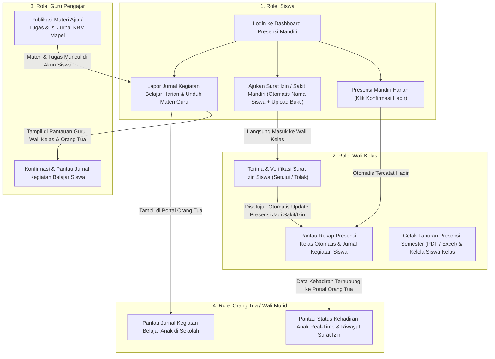

# Web Jurnal Kelas Digital (Edisi Standar Industri)

Aplikasi Web Jurnal Kegiatan Siswa, Presensi Mandiri, Pengajuan Surat Izin ke Wali Kelas, dan Portal Pantauan Orang Tua yang telah disederhanakan dan dioptimasi untuk perangkat mobile.

---

## 🔄 Poin Revisi yang Telah Diterapkan

1. **Presensi Mandiri Siswa (`/dashboard` & `POST /api/attendance/check-in`)**:
   - Siswa melakukan presensi mandiri (1-klik) langsung dari akun masing-masing saat hadir di sekolah tanpa membebani Sekretaris Kelas untuk mengabsen satu per satu.
   - Rekap presensi kelas otomatis tersinkronisasi dari presensi mandiri siswa dan surat izin yang disetujui Wali Kelas.
2. **Pengajuan Surat Izin Mandiri Siswa Langsung ke Wali Kelas (`/surat-izin`)**:
   - Menu **Pengajuan Surat Izin** kini berada langsung di akun **Siswa** dengan kartu **Informasi Pemohon (Otomatis)** sesuai akun siswa yang login (sesuai desain awal PDF Halaman 9), tanpa perlu tanda tangan manual canvas dan tanpa perlu diinput ulang oleh Sekretaris.
   - Permohonan langsung masuk ke **Wali Kelas** dan ketika disetujui, status presensi siswa otomatis tercatat sebagai `SAKIT` atau `IZIN`.
3. **Core Aplikasi: Jurnal Kegiatan Belajar Siswa & Portal Pantauan Orang Tua (`/jurnal-pelajaran` & Role `ORANG_TUA`)**:
   - Siswa dapat melaporkan **Jurnal Kegiatan Belajar Harian** yang mereka kerjakan di sekolah pada menu **Jurnal Kegiatan Siswa & Materi** (`/jurnal-pelajaran`).
   - Tersedia role baru **Orang Tua / Wali Murid (`ORANG_TUA`)** lengkap dengan tombol **Quick Login Orang Tua Siswa** di halaman `/login` untuk memantau kehadiran anak secara *real-time*, riwayat surat izin, serta jurnal kegiatan belajar anak di sekolah.
4. **Penyesuaian Penamaan Role `Wali Kelas`**:
   - Seluruh istilah tampilan `Guru Pembimbing` / `Guru Pembimbing Sekolah` telah disesuaikan menjadi **Wali Kelas** agar sesuai dengan tata kelola kelas di sekolah.

---

## 📊 Diagram User Flow (Alur Pengguna yang Disederhanakan)



---

## 🚀 Cara Menjalankan Project

### 1. Database (MySQL)
Pastikan MySQL sudah aktif (misal lewat XAMPP/Laragon di port `3306`), lalu buat database:
```sql
CREATE DATABASE jurnal_kelas_digital;
```

### 2. Backend (Laravel 11)
Masuk ke direktori `backend`:
```bash
cd backend
composer install
php artisan migrate:fresh --seed
php artisan serve --port=8000
```
Backend API berjalan di: `http://localhost:8000`

### 3. Frontend (Nuxt 3)
Masuk ke direktori `frontend`:
```bash
cd frontend
npm install
npm run dev
```
Frontend Web App berjalan di: `http://localhost:3000`

---

## 👥 Akun Uji Coba & Tombol Quick Login

Semua akun menggunakan kata sandi default: **`password123`** (atau klik langsung tombol **Akses Cepat Pengguna** di halaman `/login`):

| Peran | Nama Akun Demo | Email | Hak Akses Utama |
| :--- | :--- | :--- | :--- |
| **Siswa (Mandiri)** | Jimmy Fadhilah | `jimmy@sekolah.sch.id` | Presensi Mandiri Harian (1-Klik), Pengajuan Surat Izin Mandiri ke Wali Kelas, Lapor Jurnal Kegiatan Belajar, & Unduh Materi |
| **Wali Kelas** | Wali Kelas Binaan, S.Pd | `walikelas@sekolah.sch.id` | Verifikasi / Persetujuan Surat Izin Siswa, Pantau Rekap Presensi & Jurnal Kegiatan Kelas Binaan, Ekspor PDF/Excel |
| **Guru Pengajar** | Bagas Pratama, S.Kom | `bagas@sekolah.sch.id` | Publikasi Rencana Belajar & Modul Materi, Konfirmasi Jurnal Kegiatan KBM Siswa |
| **Orang Tua Siswa** | Bpk. Fadhilah (Orang Tua Jimmy) | `orangtua@sekolah.sch.id` | Portal Pantauan Kehadiran Anak Real-Time, Jurnal Kegiatan Belajar Anak di Sekolah, & Riwayat Surat Izin |
| **Sekretaris Kelas** | Raffi Rasyid Rizqi / Rina Safitri | `raffi@sekolah.sch.id` | Pendamping Rekap Presensi Kelas & Pencatatan Jurnal KBM Kelas |
| **Super Admin** | Administrator Sistem | `superadmin@sekolah.sch.id` | Master Data Akademik, Manajemen Guru & Staf, Buka Kunci Presensi, WhatsApp Gateway |
