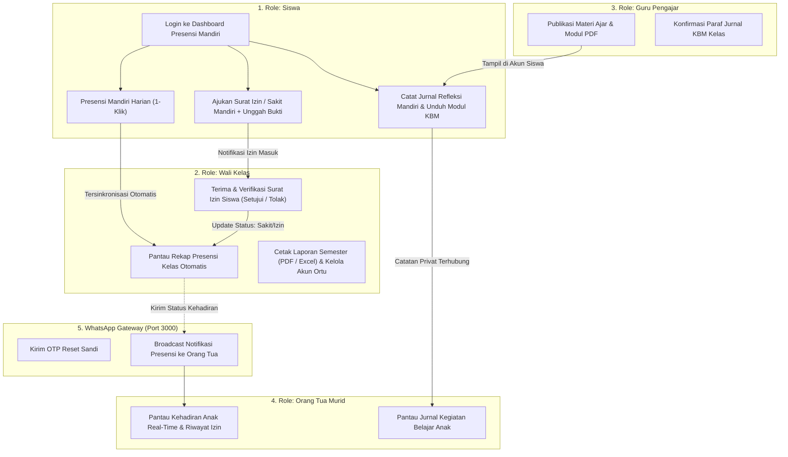

# 🏫 Web Jurnal Kelas Digital (Edisi Standar Industri)


-00DC82?logo=nuxtdotjs)


Sistem Informasi Manajemen Kegiatan Belajar Mengajar (KBM), Presensi Mandiri Siswa & Kelas, Jurnal Refleksi Mandiri, Perizinan Berjenjang, Portal Pantauan Orang Tua, serta WhatsApp Gateway Mandiri (Baileys Engine) berbasis Web & Mobile PWA.

---

## 📌 Ringkasan Arsitektur 6 Role

Sistem dirancang dengan arsitektur **Role-Based Access Control (RBAC)** ketat untuk 6 entitas pengguna:

1. **Siswa**:
   - Presensi mandiri harian (1-klik) dengan pencatatan waktu realtime.
   - Pengajuan surat izin mandiri (Sakit, Izin, Dispensasi) dilengkapi unggah bukti dokumen/foto.
   - Jurnal refleksi mandiri (`/jurnal-pelajaran`) bersifat privat (hanya siswa dan orang tua yang dapat membaca).
2. **Sekretaris Kelas**:
   - Rekap presensi kelas harian per jam KBM (`/presensi`) dan penanda verifikasi fisik jika izin ditolak.
   - Pengisian buku agenda KBM kelas (`/jurnal-kelas`) dan materi ajar.
   - Kartu presensi mandiri sekretaris di dashboard dan kuota ketat 1–2 sekretaris per rombel.
3. **Orang Tua Murid (`ORANG_TUA`)**:
   - Portal pantauan kehadiran anak secara *real-time* setiap hari.
   - Pemantauan jurnal kegiatan belajar & catatan refleksi harian anak di sekolah.
   - Riwayat surat izin anak dan status persetujuan Wali Kelas.
4. **Wali Kelas (Guru Pembimbing)**:
   - Verifikasi dan persetujuan surat izin siswa binaan (`/persetujuan-izin`) dengan input alasan wajib jika menolak.
   - Manajemen murid kelas binaan (`/manajemen-murid`), pembuatan akun orang tua, dan mutasi sekretaris.
   - Ekspor rekap presensi semester dan laporan harian (PDF & Excel).
5. **Guru Pengajar (Guru Mapel)**:
   - Akses jadwal KBM terintegrasi per hari (Senin–Jumat) di `/jurnal-materi`.
   - Publikasi rencana materi ajar, modul PDF, dan paraf konfirmasi agenda KBM kelas.
6. **Super Administrator**:
   - Manajemen master data (Rombel, Mata Pelajaran, Jadwal Pelajaran, Semester/Tahun Ajaran).
   - Pengaturan institusi sekolah (NPSN, Alamat, Nama & NIP Kepala Sekolah, Jam Sekolah, PIN Buka Presensi).
   - WhatsApp Gateway Pairing, Broadcast Notifikasi, dan Audit Trail Explorer.

---

## 📱 WhatsApp Gateway Mandiri (Baileys Engine v2.0)

Aplikasi dilengkapi microservice gateway WhatsApp mandiri berbasis **`@whiskeysockets/baileys`** di port `3000` tanpa ketergantungan pada vendor/API berbayar pihak ketiga:

* **Entrypoint:** File `server.js` di root repositori atau `wa-gateway/server.js`.
* **Metode Pairing:** Mendukung **Kode Pairing Resmi Meta (8-digit `ABCD-EFGH`)** yang dimasukkan di WhatsApp HP (*Perangkat Tertaut* > *Tautkan dengan nomor telepon*) serta QR Code.
* **Auto Handshake:** Mendukung fast-handoff reconnect pada error `515 (restartRequired)` dan pencegahan disconnect tak terduga.
* **Validasi Penerima:** Verifikasi `sock.onWhatsApp()` sebelum pengiriman pesan guna memastikan nomor aktif di WhatsApp.
* **Fungsi Utama:**
  - Pengiriman kode OTP Reset Kata Sandi mandiri (`/forgot-password`).
  - Pengiriman notifikasi kehadiran dan ketidakhadiran siswa otomatis ke nomor kontak orang tua.
  - Broadcast pengumuman sekolah langsung dari dashboard Superadmin.

---

## 🛡️ Keamanan & Hardening Sistem

1. **Cloudflare Turnstile Anti-Bot:**
   - Diberlakukan ketat pada endpoint otentikasi login (`POST /api/auth/login`) dan request OTP (`POST /api/auth/forgot-password/step-1`). Request bot/dummy langsung ditolak (HTTP 422).
2. **Rate Limiting:**
   - Throttling ketat 3 percobaan per 10 menit (`throttle:3,10`) pada endpoint sensitif OTP guna mencegah spamming SMS/WA.
3. **Browser Security Headers:**
   - Penerapan `X-Frame-Options: SAMEORIGIN`, `X-Content-Type-Options: nosniff`, dan `Referrer-Policy: strict-origin-when-cross-origin`.
   - Header fingerprinting `X-Powered-By` di-strip sepenuhnya baik di level Nginx maupun Laravel.
4. **Optimasi Mobile & Touch Ergonomics:**
   - Seluruh tabel data otomatis dikonversi ke *Card List* di mobile (`< 768px`).
   - Modal desktop ditransformasikan ke *Bottom Sheet Drawer* dengan safe area padding.
   - Seluruh form input di mobile dipatok minimal `16px` untuk mencegah auto-zoom iOS Safari.

---

## 📊 Diagram Alur Pengguna



---

## 🚀 Panduan Instalasi & Menjalankan

### Prasyarat Sistem
* **PHP:** >= 8.2 (ekstensi `pdo_sqlite` / `pdo_mysql`, `mbstring`, `fileinfo`, `curl`)
* **Node.js:** >= 18.x
* **Composer:** >= 2.5
* **NPM / Bun / Yarn**

---

### Langkah 1: Setup Backend API (Laravel 11)

Navigasikan ke direktori `backend`:

```bash
cd backend

# 1. Pasang dependensi PHP
composer install

# 2. Siapkan file konfigurasi environment
cp .env.example .env

# 3. Generate Application Key
php artisan key:generate

# 4. Jalankan Migrasi & Seeder Database
php artisan migrate --force
php artisan db:seed --force

# 5. Buat tautan penyimpanan publik (untuk upload bukti izin & avatar)
php artisan storage:link

# 6. Jalankan backend service
php artisan serve --port=8000
```
> **Info:** Backend API aktif melayani request di `http://127.0.0.1:8000`.

---

### Langkah 2: Setup WhatsApp Gateway Service (Baileys Engine)

Jalankan gateway WhatsApp di port `3000`:

```bash
# Opsi A: Jalankan langsung dari root proyek
node server.js

# Opsi B: Jalankan dari direktori wa-gateway
cd wa-gateway
npm install
npm start
```
> **Info:** WhatsApp Gateway aktif di `http://127.0.0.1:3000`. Buka antarmuka Superadmin di menu **WhatsApp Gateway** (`/wa-gateway`) untuk menautkan nomor HP sekolah via Kode Pairing.

---

### Langkah 3: Setup Frontend Web (Nuxt 3)

Navigasikan ke direktori `frontend`:

```bash
cd frontend

# 1. Pasang dependensi Node.js
npm install

# 2. Jalankan development server
npm run dev
```
> **Info:** Web App aktif di `http://localhost:3000`. Untuk build produksi VPS:
```bash
npm run build
node .output/server/index.mjs
```

---

## 👥 Akun Uji Coba (Demo Kredensial)

Semua akun demo menggunakan kata sandi default: **`password123`** (atau klik tombol **Akses Cepat Pengguna** di halaman `/login`):

| Peran (Role) | Nama Akun Demo | Email | Hak Akses Utama |
| :--- | :--- | :--- | :--- |
| **Siswa (Mandiri)** | Jimmy Fadhilah | `jimmy@sekolah.sch.id` | Presensi Mandiri Harian, Surat Izin Mandiri, Jurnal Kegiatan Belajar |
| **Wali Kelas** | Wali Kelas Binaan, S.Pd | `walikelas@sekolah.sch.id` | Persetujuan Izin Siswa, Rekap Presensi Rombel, Manajemen Murid & Ortu |
| **Guru Pengajar** | Bagas Pratama, S.Kom | `bagas@sekolah.sch.id` | Publikasi Jadwal/Modul KBM, Paraf Verifikasi Jurnal KBM Kelas |
| **Orang Tua Murid** | Bpk. Fadhilah (Ortu Jimmy) | `orangtua@sekolah.sch.id` | Portal Pantauan Kehadiran Realtime & Jurnal Belajar Anak |
| **Sekretaris Kelas** | Raffi Rasyid Rizqi | `raffi@sekolah.sch.id` | Rekap Presensi Kelas per Jam KBM, Pengisian Agenda KBM Kelas |
| **Super Administrator** | Administrator Sistem | `superadmin@sekolah.sch.id` | Master Data Akademik, Pengaturan Sistem Sekolah, WhatsApp Gateway |

---

## 👨‍💻 Lisensi & Hak Cipta
Dikembangkan untuk keperluan operasional akademik dan sistem informasi manajemen kelas digital terpadu.
Didistribusikan di bawah lisensi open-source **MIT License**.
